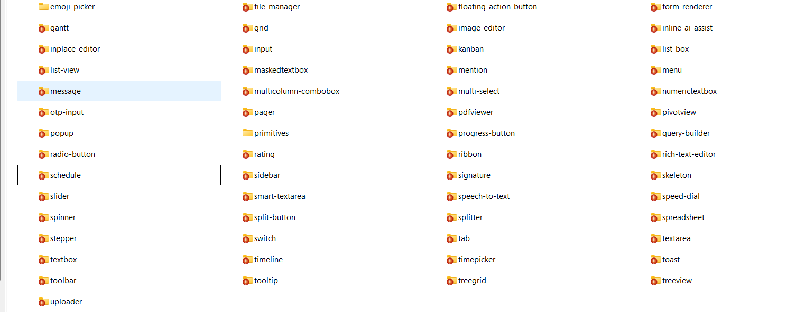

# Component-Specific CSS Architecture in Blazor Themes

The Syncfusion&reg; Blazor Themes are now published as a **component-specific CSS package architecture**. Every supported theme is split into a shared **Base** package and a set of individual **component** packages, so applications can load only the styles required by the components they use.

Instead of referencing a single, all-in-one theme stylesheet, you reference the **Base** stylesheet followed by one stylesheet per component that is rendered in the application. The Base stylesheet must always be loaded first because it provides the common styles, variables, typography, animations, utility classes, and shared component dependencies that every Syncfusion&reg; Blazor component relies on.

## Overview

Each theme is now distributed as a set of stylesheets organized into three logical groups:

* **Base package** – A mandatory `base.min.css` stylesheet that contains the shared styles, design tokens (CSS custom properties), typography, animations, utility classes, and styles for components that other components depend on (for example, icons, popup container, ripple effect).
* **Component packages** – One `.min.css` file per Syncfusion&reg; Blazor component that contains the styles specific to that component. Applications reference only the component stylesheets that match the components they render.
* **Lite variants** – Optional optimized builds (for example, `fluent2-dark-lite`) that omit the bigger size mode styles and provide a reduced CSS footprint while preserving visual consistency.

The standard reference for a single component looks like the following example for the [Blazor Diagram](https://www.syncfusion.com/blazor-components/blazor-diagram) component using the Fluent 2 Dark theme:

```html
<link rel="stylesheet" href="_content/Syncfusion.Blazor.Themes/fluent2-dark/base/base.min.css" />
<link rel="stylesheet" href="_content/Syncfusion.Blazor.Themes/fluent2-dark/diagram/diagram.min.css" />
```

The **first** stylesheet (`base.min.css`) is required. The remaining stylesheets are added **only for the components that are actually used** in the application.

## Why use component-specific CSS

Referencing only the required component styles offers the following advantages:

* **Reduced CSS payload** – Avoid loading styles for components that are not used in the application.
* **Faster initial load** – Smaller CSS files mean less data to download, parse, and apply, which improves first-paint and time-to-interactive metrics.
* **Better production hygiene** – The styles referenced in the host page match exactly the components rendered by the application.
* **Predictable upgrades** – New components added to a theme package do not bloat the existing application bundle because each application explicitly references the styles it needs.

N> The component-specific CSS references can be used with all reference methods supported by Syncfusion&reg; Blazor: static web assets, the Syncfusion&reg; CDN, the [Custom Resource Generator (CRG)](https://blazor.syncfusion.com/documentation/common/custom-resource-generator), and [Theme Studio](https://blazor.syncfusion.com/documentation/appearance/theme-studio).

## Component-specific CSS references

Applications reference the **Base** stylesheet once and then add a `<link>` tag only for each component that is rendered. The following examples show the most common scenarios.

### Diagram component

For an application that renders only the [Blazor Diagram](https://www.syncfusion.com/blazor-components/blazor-diagram) component, reference the Base stylesheet and the Diagram component stylesheet:

```html
<link rel="stylesheet" href="_content/Syncfusion.Blazor.Themes/fluent2-dark/base/base.min.css" />
<link rel="stylesheet" href="_content/Syncfusion.Blazor.Themes/fluent2-dark/diagram/diagram.min.css" />
```

### Grid component

For an application that renders only the [Blazor DataGrid](https://www.syncfusion.com/blazor-components/blazor-datagrid) component, reference the Base stylesheet and the DataGrid component stylesheet:

```html
<link rel="stylesheet" href="_content/Syncfusion.Blazor.Themes/fluent2-dark/base/base.min.css" />
<link rel="stylesheet" href="_content/Syncfusion.Blazor.Themes/fluent2-dark/grid/grid.min.css" />
```

### Multiple components

For an application that uses the [Blazor Button](https://www.syncfusion.com/blazor-components/blazor-button), [Blazor DataGrid](https://www.syncfusion.com/blazor-components/blazor-datagrid), and [Blazor Diagram](https://www.syncfusion.com/blazor-components/blazor-diagram) components together, add a stylesheet for each component after the Base stylesheet:

```html
<link rel="stylesheet" href="_content/Syncfusion.Blazor.Themes/fluent2-dark/base/base.min.css" />
<link rel="stylesheet" href="_content/Syncfusion.Blazor.Themes/fluent2-dark/button/button.min.css" />
<link rel="stylesheet" href="_content/Syncfusion.Blazor.Themes/fluent2-dark/grid/grid.min.css" />
<link rel="stylesheet" href="_content/Syncfusion.Blazor.Themes/fluent2-dark/diagram/diagram.min.css" />
```

The order of the component stylesheets after `base.min.css` does not matter. The Base stylesheet must always appear first.

## Lite theme support

The component-specific CSS references are available for both **standard** and **lite** theme variants. Switch from a standard theme to its lite equivalent by changing the theme folder name from `<theme-name>` to `<theme-name>-lite`. The internal folder structure and component stylesheet names are identical between the two variants.

### Standard theme example

```html
<link rel="stylesheet" href="_content/Syncfusion.Blazor.Themes/fluent2-dark/base/base.min.css" />
<link rel="stylesheet" href="_content/Syncfusion.Blazor.Themes/fluent2-dark/diagram/diagram.min.css" />
```

### Lite theme example

```html
<link rel="stylesheet" href="_content/Syncfusion.Blazor.Themes/fluent2-dark-lite/base/base.min.css" />
<link rel="stylesheet" href="_content/Syncfusion.Blazor.Themes/fluent2-dark-lite/diagram/diagram.min.css" />
```

The lite theme variant provides a smaller CSS footprint because it excludes the bigger size mode styles. Use the lite variant when the application does not use the bigger size mode (the `.e-bigger` class). Refer to the [lite theme documentation](https://blazor.syncfusion.com/documentation/appearance/themes#lite-theme-files) for details on when to choose the lite variant.

N> Lite themes preserve the appearance and functionality of Syncfusion&reg; Blazor components while delivering a reduced CSS payload.

## Component-to-CSS reference

For each theme, the stylesheets are published as individual folders under the theme name inside the `Syncfusion.Blazor.Themes` static web assets. Each component folder contains a single `.min.css` file whose name matches the folder name (for example, `grid/grid.min.css`). The image below shows the full set of component folders shipped with a theme package:



The following table maps every Syncfusion&reg; Blazor component that has a component-specific CSS package to its stylesheet path. Replace `<THEME-NAME>` with the theme folder you are using (for example, `fluent2-dark`, `material3`, `bootstrap5.3`, `tailwind3`, or `highcontrast`), and append `-lite` for the lite variant (for example, `fluent2-dark-lite`).

<table>
  <thead>
    <tr>
      <th style="width:32%">Component</th>
      <th>Static web asset path</th>
    </tr>
  </thead>
  <tbody>
    <tr>
      <td>Base (mandatory)</td>
      <td><code>_content/Syncfusion.Blazor.Themes/&lt;THEME-NAME&gt;/base/base.min.css</code></td>
    </tr>
    <tr>
      <td>Button, CheckBox, Chips, RadioButton, Toggle Switch Button</td>
      <td><code>_content/Syncfusion.Blazor.Themes/&lt;THEME-NAME&gt;/button/button.min.css</code></td>
    </tr>
    <tr>
      <td>ButtonGroup</td>
      <td><code>_content/Syncfusion.Blazor.Themes/&lt;THEME-NAME&gt;/button-group/button-group.min.css</code></td>
    </tr>
    <tr>
      <td>Floating Action Button</td>
      <td><code>_content/Syncfusion.Blazor.Themes/&lt;THEME-NAME&gt;/floating-action-button/floating-action-button.min.css</code></td>
    </tr>
    <tr>
      <td>ProgressButton</td>
      <td><code>_content/Syncfusion.Blazor.Themes/&lt;THEME-NAME&gt;/progress-button/progress-button.min.css</code></td>
    </tr>
    <tr>
      <td>Speed Dial</td>
      <td><code>_content/Syncfusion.Blazor.Themes/&lt;THEME-NAME&gt;/speed-dial/speed-dial.min.css</code></td>
    </tr>
    <tr>
      <td>Split Button</td>
      <td><code>_content/Syncfusion.Blazor.Themes/&lt;THEME-NAME&gt;/split-button/split-button.min.css</code></td>
    </tr>
    <tr>
      <td>Stepper</td>
      <td><code>_content/Syncfusion.Blazor.Themes/&lt;THEME-NAME&gt;/stepper/stepper.min.css</code></td>
    </tr>
    <tr>
      <td>Calendar</td>
      <td><code>_content/Syncfusion.Blazor.Themes/&lt;THEME-NAME&gt;/calendar/calendar.min.css</code></td>
    </tr>
    <tr>
      <td>DatePicker</td>
      <td><code>_content/Syncfusion.Blazor.Themes/&lt;THEME-NAME&gt;/datepicker/datepicker.min.css</code></td>
    </tr>
    <tr>
      <td>DateRangePicker</td>
      <td><code>_content/Syncfusion.Blazor.Themes/&lt;THEME-NAME&gt;/daterangepicker/daterangepicker.min.css</code></td>
    </tr>
    <tr>
      <td>DateTimePicker</td>
      <td><code>_content/Syncfusion.Blazor.Themes/&lt;THEME-NAME&gt;/datetimepicker/datetimepicker.min.css</code></td>
    </tr>
    <tr>
      <td>TimePicker</td>
      <td><code>_content/Syncfusion.Blazor.Themes/&lt;THEME-NAME&gt;/timepicker/timepicker.min.css</code></td>
    </tr>
    <tr>
      <td>OTP Input</td>
      <td><code>_content/Syncfusion.Blazor.Themes/&lt;THEME-NAME&gt;/otp-input/otp-input.min.css</code></td>
    </tr>
    <tr>
      <td>DataGrid</td>
      <td><code>_content/Syncfusion.Blazor.Themes/&lt;THEME-NAME&gt;/grid/grid.min.css</code></td>
    </tr>
    <tr>
      <td>TreeGrid</td>
      <td><code>_content/Syncfusion.Blazor.Themes/&lt;THEME-NAME&gt;/treegrid/treegrid.min.css</code></td>
    </tr>
    <tr>
      <td>Pivot Table</td>
      <td><code>_content/Syncfusion.Blazor.Themes/&lt;THEME-NAME&gt;/pivotview/pivotview.min.css</code></td>
    </tr>
    <tr>
      <td>AutoComplete, ComboBox, DropDownList, MultiSelect, MultiColumn ComboBox</td>
      <td><code>_content/Syncfusion.Blazor.Themes/&lt;THEME-NAME&gt;/combobox/combobox.min.css</code></td>
    </tr>
    <tr>
      <td>ListBox</td>
      <td><code>_content/Syncfusion.Blazor.Themes/&lt;THEME-NAME&gt;/list-box/list-box.min.css</code></td>
    </tr>
    <tr>
      <td>Diagram</td>
      <td><code>_content/Syncfusion.Blazor.Themes/&lt;THEME-NAME&gt;/diagram/diagram.min.css</code></td>
    </tr>
    <tr>
      <td>DocumentEditor</td>
      <td><code>_content/Syncfusion.Blazor.Themes/&lt;THEME-NAME&gt;/document-editor/document-editor.min.css</code></td>
    </tr>
    <tr>
      <td>PDF Viewer</td>
      <td><code>_content/Syncfusion.Blazor.Themes/&lt;THEME-NAME&gt;/pdfviewer/pdfviewer.min.css</code></td>
    </tr>
    <tr>
      <td>RichTextEditor</td>
      <td><code>_content/Syncfusion.Blazor.Themes/&lt;THEME-NAME&gt;/rich-text-editor/rich-text-editor.min.css</code></td>
    </tr>
    <tr>
      <td>Spreadsheet</td>
      <td><code>_content/Syncfusion.Blazor.Themes/&lt;THEME-NAME&gt;/spreadsheet/spreadsheet.min.css</code></td>
    </tr>
    <tr>
      <td>EmojiPicker</td>
      <td><code>_content/Syncfusion.Blazor.Themes/&lt;THEME-NAME&gt;/emoji-picker/emoji-picker.min.css</code></td>
    </tr>
    <tr>
      <td>FileManager</td>
      <td><code>_content/Syncfusion.Blazor.Themes/&lt;THEME-NAME&gt;/file-manager/file-manager.min.css</code></td>
    </tr>
    <tr>
      <td>Form Renderer</td>
      <td><code>_content/Syncfusion.Blazor.Themes/&lt;THEME-NAME&gt;/form-renderer/form-renderer.min.css</code></td>
    </tr>
    <tr>
      <td>Gantt</td>
      <td><code>_content/Syncfusion.Blazor.Themes/&lt;THEME-NAME&gt;/gantt/gantt.min.css</code></td>
    </tr>
    <tr>
      <td>ImageEditor</td>
      <td><code>_content/Syncfusion.Blazor.Themes/&lt;THEME-NAME&gt;/image-editor/image-editor.min.css</code></td>
    </tr>
    <tr>
      <td>Inline AI Assist</td>
      <td><code>_content/Syncfusion.Blazor.Themes/&lt;THEME-NAME&gt;/inline-ai-assist/inline-ai-assist.min.css</code></td>
    </tr>
    <tr>
      <td>In-place Editor</td>
      <td><code>_content/Syncfusion.Blazor.Themes/&lt;THEME-NAME&gt;/inplace-editor/inplace-editor.min.css</code></td>
    </tr>
    <tr>
      <td>Kanban</td>
      <td><code>_content/Syncfusion.Blazor.Themes/&lt;THEME-NAME&gt;/kanban/kanban.min.css</code></td>
    </tr>
    <tr>
      <td>ListView</td>
      <td><code>_content/Syncfusion.Blazor.Themes/&lt;THEME-NAME&gt;/list-view/list-view.min.css</code></td>
    </tr>
    <tr>
      <td>MaskedTextBox</td>
      <td><code>_content/Syncfusion.Blazor.Themes/&lt;THEME-NAME&gt;/maskedtextbox/maskedtextbox.min.css</code></td>
    </tr>
    <tr>
      <td>Mention</td>
      <td><code>_content/Syncfusion.Blazor.Themes/&lt;THEME-NAME&gt;/mention/mention.min.css</code></td>
    </tr>
    <tr>
      <td>Color Picker, Input (Input Mask), Numeric TextBox, Range Slider, TextBox, Uploader (File Upload), Signature</td>
      <td><code>_content/Syncfusion.Blazor.Themes/&lt;THEME-NAME&gt;/input/input.min.css</code></td>
    </tr>
    <tr>
      <td>Accordion, AppBar, Breadcrumb, Carousel, ContextMenu, Pager, Sidebar, Tabs, Toolbar, TreeView</td>
      <td><code>_content/Syncfusion.Blazor.Themes/&lt;THEME-NAME&gt;/navigations/navigations.min.css</code></td>
    </tr>
    <tr>
      <td>Avatar, Badge, Card, Dashboard Layout, Splitter</td>
      <td><code>_content/Syncfusion.Blazor.Themes/&lt;THEME-NAME&gt;/layouts/layouts.min.css</code></td>
    </tr>
    <tr>
      <td>Message, Skeleton, Spinner</td>
      <td><code>_content/Syncfusion.Blazor.Themes/&lt;THEME-NAME&gt;/notification/notification.min.css</code></td>
    </tr>
    <tr>
      <td>Dialog (and Predefined Dialogs), Popup, Toast, Tooltip</td>
      <td><code>_content/Syncfusion.Blazor.Themes/&lt;THEME-NAME&gt;/popups/popups.min.css</code></td>
    </tr>
    <tr>
      <td>Rating</td>
      <td><code>_content/Syncfusion.Blazor.Themes/&lt;THEME-NAME&gt;/rating/rating.min.css</code></td>
    </tr>
    <tr>
      <td>Scheduler</td>
      <td><code>_content/Syncfusion.Blazor.Themes/&lt;THEME-NAME&gt;/schedule/schedule.min.css</code></td>
    </tr>
    <tr>
      <td>Ribbon</td>
      <td><code>_content/Syncfusion.Blazor.Themes/&lt;THEME-NAME&gt;/ribbon/ribbon.min.css</code></td>
    </tr>
    <tr>
      <td>QueryBuilder</td>
      <td><code>_content/Syncfusion.Blazor.Themes/&lt;THEME-NAME&gt;/query-builder/query-builder.min.css</code></td>
    </tr>
    <tr>
      <td>Smart TextArea</td>
      <td><code>_content/Syncfusion.Blazor.Themes/&lt;THEME-NAME&gt;/smart-textarea/smart-textarea.min.css</code></td>
    </tr>
    <tr>
      <td>Speech To Text</td>
      <td><code>_content/Syncfusion.Blazor.Themes/&lt;THEME-NAME&gt;/speech-to-text/speech-to-text.min.css</code></td>
    </tr>
    <tr>
      <td>Switch</td>
      <td><code>_content/Syncfusion.Blazor.Themes/&lt;THEME-NAME&gt;/switch/switch.min.css</code></td>
    </tr>
    <tr>
      <td>TextArea</td>
      <td><code>_content/Syncfusion.Blazor.Themes/&lt;THEME-NAME&gt;/textarea/textarea.min.css</code></td>
    </tr>
    <tr>
      <td>Timeline</td>
      <td><code>_content/Syncfusion.Blazor.Themes/&lt;THEME-NAME&gt;/timeline/timeline.min.css</code></td>
    </tr>
    <tr>
      <td>TreeMap</td>
      <td><code>_content/Syncfusion.Blazor.Themes/&lt;THEME-NAME&gt;/treemap/treemap.min.css</code></td>
    </tr>
    <tr>
      <td>Slider (Range Slider)</td>
      <td><code>_content/Syncfusion.Blazor.Themes/&lt;THEME-NAME&gt;/slider/slider.min.css</code></td>
    </tr>
    <tr>
      <td>Primitives (shared building blocks)</td>
      <td><code>_content/Syncfusion.Blazor.Themes/&lt;THEME-NAME&gt;/primitives/primitives.min.css</code></td>
    </tr>
  </tbody>
</table>

N> Some Syncfusion&reg; Blazor components share styles with another component. For example, the [Toggle Switch Button](https://www.syncfusion.com/blazor-components/blazor-toggle-switch-button) component uses the same `button.min.css` stylesheet as the [Button](https://www.syncfusion.com/blazor-components/blazor-button) component. Refer to the stylesheet shared by the related component when only one of the linked components is rendered.

## Where to reference the styles

Add the Base and component-specific `<link>` tags to the host page of your application. The exact file depends on the Blazor application model:

* For a **Blazor Web App** using **Server**, **WebAssembly**, or **Auto** interactive render modes, add the references in the `<head>` section of **`~/Components/App.razor`**.
* For a **Blazor WebAssembly standalone app**, add the references in the `<head>` section of **`~/wwwroot/index.html`**.

The following example shows a Blazor Web App that renders the [Blazor Diagram](https://www.syncfusion.com/blazor-components/blazor-diagram), [Blazor DataGrid](https://www.syncfusion.com/blazor-components/blazor-datagrid), and [Blazor Button](https://www.syncfusion.com/blazor-components/blazor-button) components using the Fluent 2 Dark theme:

```html
<!DOCTYPE html>
<html lang="en">
<head>
    <meta charset="utf-8" />
    <meta name="viewport" content="width=device-width, initial-scale=1.0" />
    <base href="/" />

    <!-- Syncfusion Blazor Themes: Base (mandatory) + components used by this app -->
    <link rel="stylesheet" href="_content/Syncfusion.Blazor.Themes/fluent2-dark/base/base.min.css" />
    <link rel="stylesheet" href="_content/Syncfusion.Blazor.Themes/fluent2-dark/button/button.min.css" />
    <link rel="stylesheet" href="_content/Syncfusion.Blazor.Themes/fluent2-dark/grid/grid.min.css" />
    <link rel="stylesheet" href="_content/Syncfusion.Blazor.Themes/fluent2-dark/diagram/diagram.min.css" />
</head>
<body>
    ...
</body>
</html>
```

To ensure the host can serve the static web assets, verify that [UseStaticFiles](https://learn.microsoft.com/en-us/dotnet/api/microsoft.aspnetcore.builder.staticfileextensions.usestaticfiles) is called in `~/Program.cs`. For a **Blazor Web App**, this is required in the server project. A standalone **Blazor WebAssembly** app does not require any server-side middleware configuration.

## CDN reference

The component-specific CSS packages are also available on the Syncfusion&reg; CDN under the theme folder. Replace the static web asset path with the CDN URL, keeping the same `base/<component>/<file>` layout:

```html
<link rel="stylesheet" href="https://cdn.syncfusion.com/blazor/{{ site.blazorversion }}/styles/fluent2-dark/base/base.min.css" rel="stylesheet" />
<link rel="stylesheet" href="https://cdn.syncfusion.com/blazor/{{ site.blazorversion }}/styles/fluent2-dark/diagram/diagram.min.css" rel="stylesheet" />
```

For lite variants, use the `-lite` theme folder:

```html
<link rel="stylesheet" href="https://cdn.syncfusion.com/blazor/{{ site.blazorversion }}/styles/fluent2-dark-lite/base/base.min.css" rel="stylesheet" />
<link rel="stylesheet" href="https://cdn.syncfusion.com/blazor/{{ site.blazorversion }}/styles/fluent2-dark-lite/diagram/diagram.min.css" rel="stylesheet" />
```

N> Ensure that the version in the CDN URL matches the version of the [Syncfusion.Blazor.Themes](https://www.nuget.org/packages/Syncfusion.Blazor.Themes/) NuGet package referenced by your application.

## See also

* [Apply and Customize Blazor Themes](https://blazor.syncfusion.com/documentation/appearance/themes)
* [Change Theme Dynamically in Blazor Applications](https://blazor.syncfusion.com/documentation/appearance/dynamic-theme-switching)
* [Enable Touch Friendly Size Modes in Blazor](https://blazor.syncfusion.com/documentation/appearance/size-modes)
* [Custom Resource Generator (CRG)](https://blazor.syncfusion.com/documentation/common/custom-resource-generator)
* [Theme Studio](https://blazor.syncfusion.com/documentation/appearance/theme-studio)
